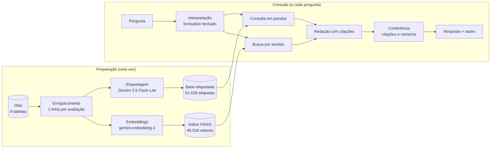
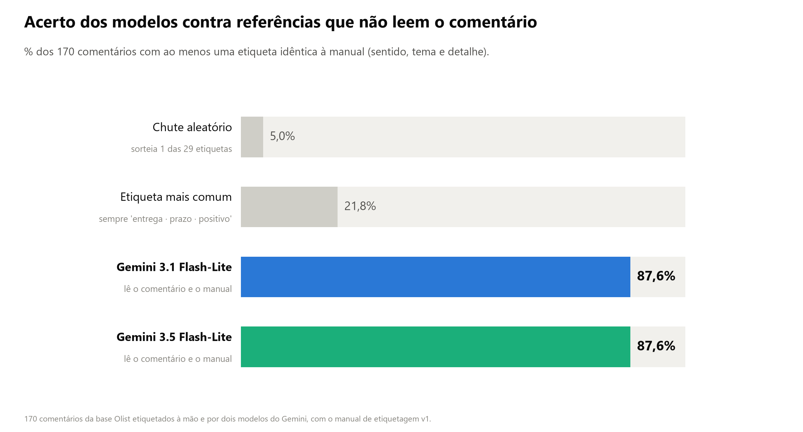
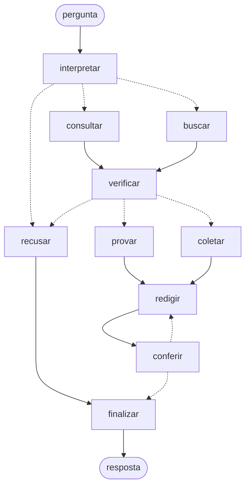
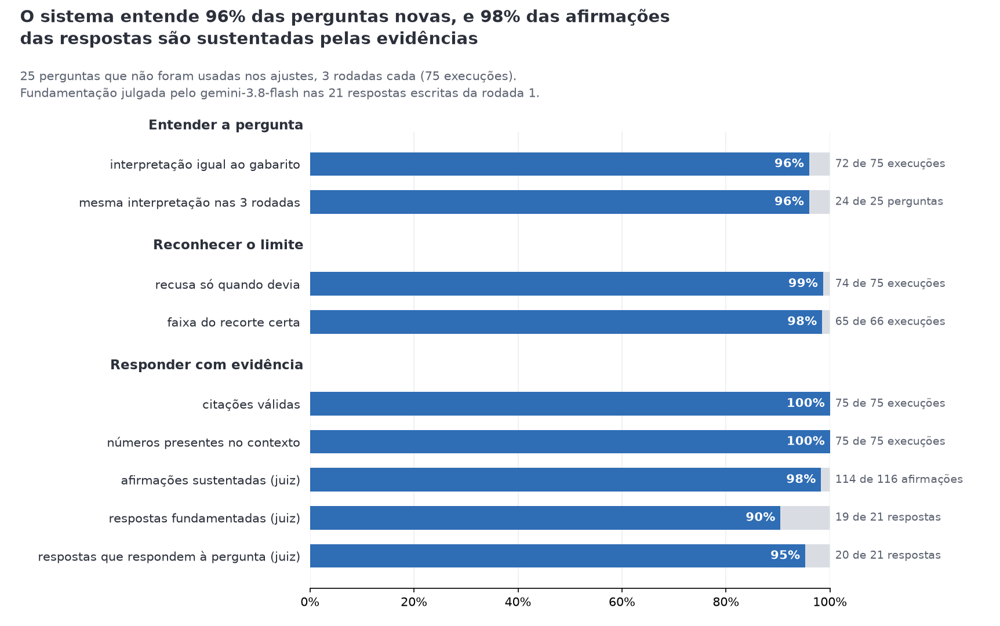
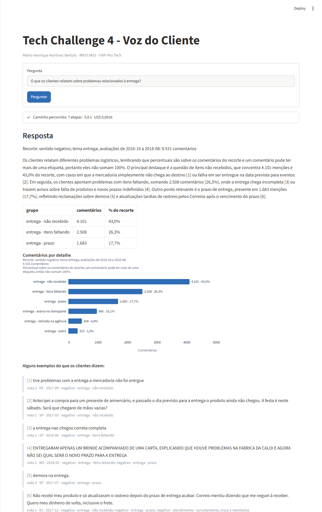
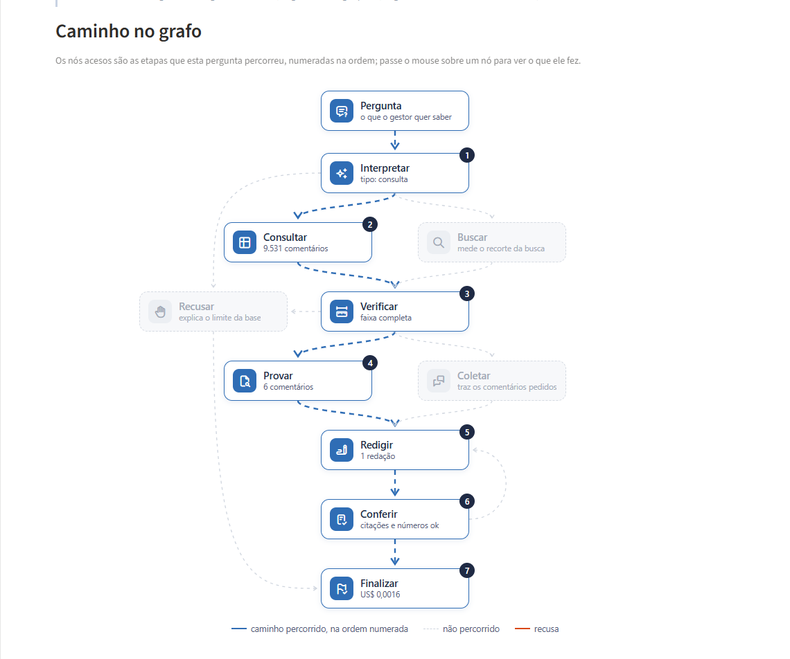

# Voz do Cliente: respostas sobre as avaliações da Olist com RAG

**Tech Challenge 4 · FIAP Pós Tech AI Scientist · Fase 4 (Deep Learning e NLP)**
Pedro Henrique Martinez Bertolo · RM373453

Sistema de consulta em linguagem natural sobre os comentários de clientes do [Brazilian E-Commerce Public Dataset by Olist](https://www.kaggle.com/datasets/olistbr/brazilian-ecommerce). O gestor pergunta em português ("quais os problemas mais apontados sobre entregas?") e recebe uma resposta com os números calculados na base inteira e os comentários reais que os sustentam, com o caminho percorrido até a resposta à vista.

## 🎥 Vídeo da apresentação

[Assistir ao vídeo no Google Drive](https://drive.google.com/drive/folders/1busd-2uO3G1CWqHQND0xmyVbTgJ0lyOi)

## Sumário

1. [Problema de negócio](#1-problema-de-negócio)
2. [Estratégia: números calculados em código, comentários como evidência](#2-estratégia-números-calculados-em-código-comentários-como-evidência)
3. [Arquitetura](#3-arquitetura)
4. [Base de conhecimento](#4-base-de-conhecimento)
5. [Etiquetagem dos comentários](#5-etiquetagem-dos-comentários)
6. [Pipeline RAG: da pergunta à resposta](#6-pipeline-rag-da-pergunta-à-resposta)
7. [Respostas fundamentadas e perguntas sem evidência suficiente](#7-respostas-fundamentadas-e-perguntas-sem-evidência-suficiente)
8. [Avaliação](#8-avaliação)
9. [Exemplos de perguntas e respostas](#9-exemplos-de-perguntas-e-respostas)
10. [Aplicação](#10-aplicação)
11. [Tecnologias e bibliotecas](#11-tecnologias-e-bibliotecas)
12. [Principais decisões técnicas](#12-principais-decisões-técnicas)
13. [Limitações e evoluções](#13-limitações-e-evoluções)
14. [Como executar](#14-como-executar)
15. [Estrutura do repositório](#15-estrutura-do-repositório)
16. [Uso de IA no desenvolvimento](#16-uso-de-ia-no-desenvolvimento)

---

## 1. Problema de negócio

Uma empresa de e-commerce acumula milhares de avaliações escritas. A nota mostra o nível de satisfação, mas o motivo está no texto, e ler milhares de comentários não é viável. Os gestores precisam responder perguntas como:

- Quais são os principais problemas relatados pelos clientes?
- Quais reclamações sobre entrega aparecem com mais frequência?
- O que os clientes mais elogiam?
- Quais padrões aparecem nas avaliações de clientes insatisfeitos?
- Quais avaliações sustentam que existem problemas recorrentes de prazo?

A base usada tem 99.224 avaliações de pedidos feitos entre 2016 e 2018; 40.518 delas têm comentário escrito e formam a base de conhecimento.

## 2. Estratégia: números calculados em código, comentários como evidência

Três das cinco perguntas acima pedem frequência ou padrão ("principais", "mais frequentes", "padrões"). Uma busca por similaridade devolve os poucos comentários mais parecidos com a pergunta, e poucos comentários não informam frequência: com cinco comentários sobre entrega, o modelo de linguagem escreveria uma estatística sem base.

Por isso a solução tem duas fontes de verdade, ligadas pelo código de cada avaliação (D-001):

| Fonte | O que entrega | Como |
|---|---|---|
| **contagem em código** | quanto: quantos comentários, que percentual, que média | cada comentário recebe etiquetas de assunto uma única vez, na preparação; uma consulta em pandas conta sobre a base inteira |
| **busca por sentido (RAG)** | o quê: os comentários que provam o número | índice vetorial FAISS com os 40.518 comentários; a busca acontece dentro do mesmo recorte da contagem |

O modelo de linguagem não produz nenhum número. Ele faz duas coisas: transforma a pergunta numa consulta com campos fechados (o que medir, como agrupar, quais filtros) e escreve a resposta a partir da tabela calculada e dos comentários recuperados, citando cada comentário. O código confere as citações e os números.

## 3. Arquitetura



A consulta é um grafo do LangGraph com dez nós, detalhado na [seção 6](#6-pipeline-rag-da-pergunta-à-resposta).

## 4. Base de conhecimento

O enunciado pede a justificativa de cada etapa da construção da base. Todas estão nos notebooks `desenv_01` a `desenv_05` e no [diário de decisões](docs/decisoes.md).

| Etapa | O que foi feito | Por quê |
|---|---|---|
| **Seleção dos dados** | as 9 tabelas da Olist entram, resumidas por pedido: datas, status, estado e cidade do cliente, categorias, valores, frete, pagamento, vendedores e a distância entre vendedor e cliente (D-017) | as perguntas sobre atraso, região, categoria e frete dependem dessas informações; a nota sozinha não explica o motivo |
| **Unidade do documento** | um documento por avaliação: 98.410 avaliações distintas em 99.224 linhas, porque a mesma avaliação aparece replicada em pedidos de uma mesma compra (D-016) | sem isso, o mesmo comentário seria contado duas vezes e citado repetido |
| **Limpeza** | dos 40.950 comentários escritos, saem os 123 sem letra nem número (".", "...", emojis); o texto é mantido como o cliente escreveu | o texto original é a evidência mostrada ao gestor |
| **Valores ausentes** | 58,7% das avaliações não têm comentário e ficam fora da busca; o título é opcional (24,1%); pedidos não entregues recebem a faixa "não entregue" em vez de atraso vazio; CEP sem localização deixa a distância vazia (D-018, D-019) | a ausência é informação: "não entregue" é a situação mais grave da jornada |
| **Pedidos com vários itens** | um pedido recebe todas as suas categorias; uma avaliação ligada a vários pedidos recebe o maior atraso (D-018) | não há como saber qual produto motivou o comentário; a pior experiência tende a motivar a avaliação |
| **Organização dos documentos** | um comentário por documento, sem divisão em pedaços (mediana de 53 caracteres, máximo de 208); só o título e o texto viram vetor; nota, mês, estado, região, situação da entrega, categorias e etiquetas vão como metadados e funcionam como filtros (D-028) | o comentário já é a menor unidade com sentido; misturar metadados no texto prejudicaria a busca por assunto |
| **Embeddings** | `gemini-embedding-2`, 768 dimensões, com o prefixo de documento nos comentários e o prefixo de busca nas perguntas; 919.767 tokens, cerca de US$ 0,18 (D-028) | mesmo provedor do modelo de linguagem; o padrão da aula 3 de LangChain (D-007) |
| **Armazenamento e indexação** | FAISS com busca exata (`IndexFlatIP`, produto interno igual ao cosseno), montado pelo LangChain e gravado em disco (D-028) | 40 mil vetores cabem na busca exata, sem perda de precisão |

**Uma descoberta da análise exploratória que muda a leitura dos números:** 76,5% das avaliações de nota 1 têm comentário, contra 35,8% das de nota 5. A nota 1 é 11,5% das avaliações, mas 21,4% dos comentários. Por isso toda resposta diz que os percentuais são sobre os comentários, e não sobre os clientes (D-013).

## 5. Etiquetagem dos comentários

A contagem depende de cada comentário ter etiquetas de assunto no formato **sentido · tema · detalhe** (por exemplo, `negativo · entrega · não recebido`). Um comentário pode ter várias etiquetas ("produto ótimo, mas a entrega atrasou"), e a nota não é usada como sentimento: ela é dada ao pedido, não ao assunto (D-009).

| Passo | Resultado |
|---|---|
| lista de temas | proposta pelo Gemini em duas amostras independentes de cerca de 1.000 comentários, comparada e revisada à mão; busca por palavras na base inteira encontrou assuntos pequenos que as propostas não tinham (D-011, D-020) |
| manual | 5 temas (entrega, produto, preço, atendimento, geral) e 13 detalhes, mais "outro" em cada tema, com definição, o que entra, o que não entra e regras de desempate; 29 etiquetas completas possíveis (D-020, D-025) |
| gabarito manual | 170 comentários etiquetados à mão, às cegas, com o mesmo manual (D-021) |
| escolha do modelo | três modelos etiquetaram os mesmos 170; o `gemini-3.5-flash-lite` acertou ao menos uma etiqueta idêntica em 87,6% dos comentários, com F1 de 0,771 por etiqueta completa e acerto de 99,1% no sentido, 95,9% no tema e 87,6% no detalhe (D-023) |
| base inteira | 40.518 comentários etiquetados em 14 minutos, por US$ 9,07, sem erro de lote; 61.628 etiquetas (D-026) |

Para comparação: um sorteio de etiquetas acertaria ao menos uma em 5,0% dos comentários, e repetir sempre a etiqueta mais comum, em 21,8%. O modelo chegou a 87,6% sem nenhum treino, só com o manual, numa tarefa com 29 etiquetas possíveis e comentários com até três etiquetas. As divergências restantes concentram-se em fronteiras de interpretação, como "atraso" e "não recebido", e o gabarito não foi ajustado depois da comparação (D-024).



O mapa 3D das etiquetas (`reports/visualizacao/grafo_etiquetas.html`, D-027) mostra quais problemas aparecem juntos: a distância entre duas etiquetas segue o quanto elas coincidem acima do acaso.

## 6. Pipeline RAG: da pergunta à resposta

O enunciado pede que a solução mostre cinco passos. Cada um é um nó (ou par de nós) do grafo do LangGraph (D-029):

| Passo do enunciado | Nó do grafo | O que acontece |
|---|---|---|
| **transformação da pergunta** | `interpretar` | o Gemini lê a pergunta e preenche um formulário Pydantic (`with_structured_output`): o tipo (consulta, busca, fora do tema, sem dado) e, conforme o tipo, a medida, o agrupamento e os filtros. Se a validação recusar o formulário, o erro volta ao modelo uma vez |
| **recuperação semântica** | `consultar`, `provar`, `coletar` | a consulta roda em pandas sobre a base etiquetada; a busca no FAISS acontece dentro do mesmo recorte, com filtros aplicados antes da busca |
| **seleção dos conteúdos** | `provar`, `coletar` | dois comentários dentro de cada um dos três primeiros grupos da tabela; diversificação por relevância marginal máxima (MMR), com corte de similaridade quando não há filtro de etiqueta (D-028) |
| **construção do contexto** | `redigir` | instruções, recorte, tabela calculada, avisos e comentários numerados |
| **geração da resposta** | `redigir`, `conferir`, `finalizar` | o modelo escreve citando os comentários pelo número; o código confere as citações e os números e anexa o texto original dos comentários citados |



As setas tracejadas são decididas pelo estado da pergunta. A volta de `conferir` para `redigir` é o único ciclo: uma citação inválida pede uma nova redação.

**A consulta tem campos fechados.** O modelo escolhe entre opções fixas, cada uma com uma descrição que ele lê:

| Campo | Opções |
|---|---|
| medida | quantidade de comentários, nota média, dias de atraso, prazo de entrega, distância vendedor-cliente, frete, valor dos produtos |
| agrupar por | sentido, tema, detalhe, etiqueta, pares de etiquetas, mês, estado, região, categoria, nota, situação da entrega |
| filtros | os mesmos campos, mais o período |
| comparar com | um segundo grupo, para comparar médias |

As regras de cálculo ficam no código, e não dependem do modelo lembrar delas: dias de atraso só contam pedidos entregues depois da data prevista (53% das queixas de prazo chegaram dentro da data prometida, então a etiqueta mede a percepção e a data mede o atraso); grupos com menos de 30 comentários saem da tabela com aviso. Uma consulta livre escrita pelo modelo em SQL ou pandas foi descartada: um erro dela devolveria um número errado com aparência de certo.

## 7. Respostas fundamentadas e perguntas sem evidência suficiente

O enunciado pede que o sistema reconheça três situações. Cada uma tem uma resposta própria:

| Situação | Exemplo | O que o sistema faz |
|---|---|---|
| fora do escopo | "qual a cotação do dólar?" | recusa e diz o que o sistema responde |
| no tema, mas sem dado na base | "qual a distância dos centros de distribuição até as entregas atrasadas?" | recusa, diz o que a base tem de mais próximo (a distância entre vendedor e cliente) e mostra o que o sistema responde; o modelo não troca um dado por outro parecido |
| nenhuma avaliação no recorte | "o que os clientes do Amazonas criticaram no atendimento em julho de 2018?" | recusa e mostra o recorte usado |
| poucas avaliações (1 a 29) | "o que os clientes do Amazonas criticam no atendimento?" (4 comentários) | responde em **amostra pequena**: sem percentual nem ranking, resume os comentários e avisa que são poucos para concluir um padrão |

Toda resposta começa pelo recorte considerado e pela quantidade de comentários. Depois da redação, o código confere se cada comentário citado existe na lista entregue ao modelo e se cada número escrito aparece no contexto. Os comentários citados são anexados pelo código, com o texto original, sob "Alguns exemplos do que os clientes dizem:".

## 8. Avaliação

Os testes da construção usaram as mesmas perguntas para ajustar as instruções. A avaliação usou **25 perguntas novas**, com gabarito escrito antes de rodar, cada uma executada **três vezes**, porque o modelo varia entre execuções (D-030):



| Critério do enunciado | Medida | Resultado |
|---|---|---|
| recuperar conteúdos relevantes | interpretação igual ao gabarito | 96% (72 de 75 execuções) |
| | busca: comentários com a etiqueta do assunto pedido (D-028) | 96% |
| reconhecer quando não há informação suficiente | recusa só quando devia | 99% |
| | faixa do recorte certa (completo, pequeno, vazio) | 98% |
| gerar respostas coerentes com as evidências | citações válidas e números presentes no contexto | 100% |
| evitar informações não fundamentadas | afirmações sustentadas pelo contexto, segundo um modelo juiz (`gemini-3.8-flash`) | 98% (114 de 116) |
| permitir a rastreabilidade | respostas com rastro e registro | todas, por construção do fluxo |

A avaliação custou US$ 0,21. Uma resposta foi julgada não fundamentada, e a causa está na etiquetagem: um comentário com a etiqueta de prazo ("o produto chegou ontem o tecnico instalou e nao funciona") foi escolhido como prova de demora, e o modelo confiou no grupo. Nenhuma resposta inventou causa, fato ou número. O veredito do juiz foi tomado como correto, sem comparação com um julgamento humano.

## 9. Exemplos de perguntas e respostas

As respostas às oito perguntas do enunciado (exemplos de exploração e desafio adicional) estão em [reports/respostas/exemplos_enunciado.md](reports/respostas/exemplos_enunciado.md), com a interpretação e o caminho no grafo de cada uma. Um exemplo:

> **Pergunta:** O que os clientes relatam sobre problemas relacionados à entrega?
>
> **Como o sistema entendeu:** consulta; queixas (sentido negativo) do tema entrega, agrupadas por detalhe.
>
> **Resposta:** Recorte: sentido negativo; tema entrega; avaliações de 2016-10 a 2018-08: 9.531 comentários
>
> O principal problema relatado é que o produto não foi recebido, presente em 4.101 menções (43,0%), com clientes apontando que a mercadoria não chega ou ultrapassa a data prevista [1], [2]. Além disso, os clientes destacam problemas de itens faltando, representando 2.508 comentários (26,3%), onde pacotes chegam incompletos [3] ou trazem apenas brindes sem o produto principal [4]. As reclamações sobre prazo somam 1.683 menções (17,7%), evidenciando atrasos e falhas no rastreio [5], [6]. Como um comentário pode ter mais de uma etiqueta, os percentuais são sobre os comentários do recorte e não somam 100%.
>
> Alguns exemplos do que os clientes dizem:
> [1] "tive problemas com a entrega a mercadoria não foi entrgue" (nota 2, PE, 2017-09)
> [3] "a entrega nao chegou correta completa" (nota 1, SP, 2018-06)
> [4] "ENTREGARAM APENAS UM BRINDE ACOMPANHADO DE UMA CARTA, EXPLICANDO QUE HOUVE PROBLEMAS NA FABRICA DA CALOI [...]" (nota 1, MS, 2018-02)
>
> *(trecho; a resposta completa, com os seis comentários, está no arquivo de exemplos)*

Duas leituras de negócio aparecem comparando respostas: o produto não recebido pesa 34,7% nas queixas de quem deu nota 1 ou 2, contra 25,7% em todas as queixas, sendo o problema que mais derruba a nota; e quem reclama do prazo comprou de vendedores mais distantes (788 km em média, contra 595 km de quem elogia o prazo).

## 10. Aplicação

A aplicação em Streamlit (`app.py`) mostra, para cada pergunta, a resposta, as evidências e o caminho percorrido no grafo (D-031):

- **verbose ao vivo:** cada etapa aparece enquanto roda; ao fim, um resumo com etapas, tempo e custo;
- **resposta:** recorte, texto com citações, gráfico da tabela calculada e os comentários citados com nota, estado, mês e etiquetas;
- **caminho no grafo:** os nós percorridos ficam acesos e numerados na ordem; passando o mouse, cada nó mostra a sua função e o que fez naquela pergunta;
- **detalhes técnicos:** formulário preenchido pelo modelo, código da consulta, buscas, contexto exato enviado ao modelo e conferências.





Uma pergunta custa cerca de US$ 0,0014 e leva cerca de 5 segundos.

## 11. Tecnologias e bibliotecas

| Peça | Escolha | Onde |
|---|---|---|
| linguagem e ambiente | Python 3.12, ambiente criado com `uv` (D-010) | todo o projeto |
| dados | pandas, pyarrow | notebooks 01, 02 e `src/` |
| modelo de linguagem | `gemini-3.5-flash-lite` pelo `langchain-google-genai`, com saída estruturada (Pydantic) | etiquetagem, interpretação e redação |
| embeddings | `gemini-embedding-2` (768 dimensões) | índice de busca |
| banco vetorial | FAISS (`faiss-cpu`) pelo `langchain-community` | índice de busca |
| fluxo | LangGraph (`StateGraph`, arestas condicionais) | `src/fluxo.py` |
| juiz da avaliação | `gemini-3.8-flash` | notebook 07 |
| aplicação | Streamlit, Altair | `app.py` |
| visualização | matplotlib; mapa 3D com `react-force-graph-3d` | notebooks e `reports/visualizacao` |

As peças seguem as aulas de LangChain e IA Generativa da fase (D-006). O que o projeto cria é o que é específico do caso: a preparação dos dados da Olist, as etiquetas, o formulário de consulta e as verificações do fluxo.

## 12. Principais decisões técnicas

O [diário de decisões](docs/decisoes.md) registra 31 decisões, cada uma com contexto, justificativa e alternativas descartadas. As principais:

| Decisão | Escolha | Alternativa descartada |
|---|---|---|
| D-001 | número em código, texto como evidência | RAG convencional com o modelo inferindo frequência |
| D-008, D-023 | etiquetagem da base inteira pelo Gemini, medida contra 170 comentários etiquetados à mão | treinar um classificador próprio (fica como evolução) |
| D-009 | etiqueta por sentido, tema e detalhe, extraída do texto | nota da avaliação como sentimento |
| D-013 | percentuais sobre os comentários, nunca sobre os clientes | percentual sobre clientes, que daria o dobro do peso à insatisfação |
| D-016 | um documento por avaliação, sem divisão em pedaços | uma linha por pedido, com comentários repetidos |
| D-028 | busca exata no FAISS, diversificada, com corte de similaridade sem filtro de etiqueta | busca simples, que devolvia cópias da mesma frase |
| D-029 | uma consulta com campos fechados e um grafo com recusas | uma ferramenta por pergunta; consulta livre em SQL |
| D-030 | avaliação com perguntas novas, três rodadas e juiz automático | avaliar com as perguntas usadas nos ajustes |

## 13. Limitações e evoluções

| Limitação | Evolução proposta |
|---|---|
| a etiquetagem tem erros nas fronteiras (atraso × não recebido), e um deles chegou a uma resposta na avaliação | conferir o texto do comentário contra o grupo antes de usá-lo como prova; mais comentários por grupo |
| etiquetar avaliações novas exige chamar o modelo | treinar um classificador próprio com as 61.628 etiquetas (D-008) |
| a base não tem a localização dos centros de distribuição | com esse dado, cruzar distância, atraso e reclamação por região para apoiar decisões de logística (D-017) |
| cada pergunta é independente ("e em 2018?" não é entendida) | memória de conversa (D-005) |
| o modelo ignora a temperatura e pode interpretar a mesma pergunta de outro jeito (96% de estabilidade) | repetir a interpretação e usar a mais frequente nas perguntas instáveis |
| o juiz da fundamentação não foi validado contra um julgamento humano | julgar uma amostra à mão e medir a concordância |
| a divergência entre a nota e o texto, prevista no escopo, ficou fora do MVP | nova opção no formulário de consulta |
| a aplicação roda só localmente | publicar com o índice num armazenamento externo e a chave como segredo do servidor |

## 14. Como executar

**Requisitos:** Python 3.12 e uma chave da API do Google (Gemini) com faturamento ativo.

```bash
git clone https://github.com/pedrohm1986b/Tech_Challenge_RM373453_fase4_rag_voz_do_cliente.git
cd Tech_Challenge_RM373453_fase4_rag_voz_do_cliente
uv venv --python 3.12 .venv
uv pip install -r requirements.txt
```

Crie o arquivo `.env` a partir de `.env.example` e preencha `GOOGLE_API_KEY`.

**Dados:** a base é pública no Kaggle e não é versionada:

```bash
curl -L -o olist.zip https://www.kaggle.com/api/v1/datasets/download/olistbr/brazilian-ecommerce
unzip olist.zip -d data/raw
```

**Reprodução, na ordem dos notebooks:**

| Notebook | Gera | Chamadas pagas |
|---|---|---|
| `desenv_01_analise_exploratoria` | leituras da análise exploratória | não |
| `desenv_02_enriquecimento` | `data/processed/avaliacoes_enriquecidas.parquet` | não |
| `desenv_03_lista_de_temas` | propostas de temas e manual | sim (poucas) |
| `desenv_04_etiquetagem` | `data/processed/etiquetas_base.parquet` (já versionado no repositório) | sim (cerca de US$ 9 na base inteira) |
| `desenv_05_indice_busca` | `data/processed/indice_busca/` | sim (cerca de US$ 0,18) |
| `desenv_06_ferramentas_fluxo` | testes do fluxo e `reports/respostas/` | sim (centavos) |
| `desenv_07_avaliacao` | painel e tabelas da avaliação | sim (cerca de US$ 0,21) |

As etiquetas da base inteira já estão no repositório: para usar a aplicação, basta rodar os notebooks 02 e 05.

**Aplicação:**

```bash
streamlit run app.py
```

## 15. Estrutura do repositório

```
├── app.py                      aplicação Streamlit
├── src/
│   ├── busca.py                busca por sentido sobre o índice FAISS
│   ├── fluxo.py                consulta, busca de evidência e grafo LangGraph
│   ├── etiquetagem/            modelo da planilha de etiquetagem manual
│   └── visualizacao/           modelo do mapa 3D das etiquetas
├── notebooks/                  desenv_01 a desenv_07, com leitura após cada resultado
├── data/
│   ├── raw/                    base da Olist (não versionada)
│   └── processed/              base enriquecida, etiquetas e índice (só as etiquetas são versionadas)
├── reports/                    manual, etiquetagem, busca, respostas, avaliação e mapa 3D
├── images/                     figuras dos notebooks e capturas da aplicação
└── docs/
    ├── escopo.md               problema, premissas, arquitetura e etapas
    └── decisoes.md             diário de decisões (D-001 a D-031)
```

## 16. Uso de IA no desenvolvimento

Este projeto foi desenvolvido com apoio de uma ferramenta de IA generativa (Claude, da Anthropic) atuando como par de programação e tutoria, em sessões de cocriação documentadas nas Pull Requests do repositório. Todas as decisões de escopo, arquitetura e modelos, as execuções com a chave e o faturamento do Google, as validações e os merges são do autor; a divisão de papéis por atividade está descrita abaixo.

| Atividade | Papel do autor | Papel da IA |
|---|---|---|
| Escopo e decisões técnicas (D-001 a D-031) | Todas as escolhas finais, incluindo ideias de origem: consulta como formulário fechado executado em código, distância entre vendedor e cliente, corte de semelhança só nas buscas sem filtro de etiqueta, manter o gabarito manual sem revisão depois da comparação | Mapeamento de alternativas com prós e contras; registro no diário de decisões |
| Análise exploratória e hipóteses | Formulação e contestação das hipóteses (comentários positivos genéricos, Black Friday contra Natal, causa do pico de insatisfação de 2018) | Código das análises, figuras e sistematização dos achados |
| Lista de temas e manual de etiquetagem | Definição final dos temas e detalhes (frete em preço, retirada na agência em entrega) e das regras do manual v2 | Propostas de temas com o modelo de linguagem e redação do manual |
| Gabarito e medida de acordo | Etiquetagem manual dos 170 comentários da amostra; definição da medida de acordo (D-022) e escolha do modelo para a base inteira (D-023) | Planilha de etiquetagem, chamadas ao Gemini e cálculo das comparações |
| Desenvolvimento de código (notebooks `desenv_`, `src/` e `app.py`) | Direcionamento de cada célula (objetivo, insumos e resultado esperado); execução, conferência dos números e pedidos de correção | Escrita da implementação comentada em pareamento, sob o direcionamento e a validação do autor |
| Avaliação | Critérios de aceitação e decisão de usar o juiz automático | Perguntas de teste, rodadas e painel de resultados |
| Aplicação | Requisitos e retorno de usabilidade (etapas ao vivo, gráfico da tabela, caminho no grafo) | Implementação em Streamlit |
| Documentação (README e docs) | Tom, estrutura e revisão final de cada seção | Redação de rascunhos e consolidação |
| Vídeo de apresentação | Roteiro, narração, gravação e montagem | Animações em Manim sincronizadas com a narração |
| Git e Pull Requests | Revisão e aprovação de todas as PRs | Commits, branches e descrições de PR via CLI (`git`/`gh`), em nome do autor |
| Infraestrutura e custos | Chave da API, faturamento no Google Cloud e controle dos gastos | Estimativas de custo e tempo antes de cada rodada paga |

As Pull Requests registram esse fluxo etapa a etapa e constituem a evidência do processo de cocriação.
